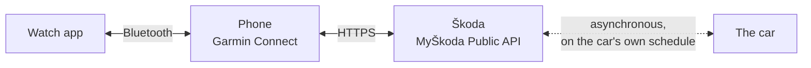

# Vozidlo


A Connect IQ watch app that reads and controls a Škoda from the wrist, through
the official MyŠkoda Public API. Charge, climate, lock status, and where the car
is parked.

*Vozidlo* is Czech for "vehicle". The app is named that rather than after the
marque, because no third-party licence exists for the Škoda marks and the brand
belongs in a compatibility statement, not in a product name.

> **Independent, unofficial app.** Not affiliated with, endorsed by, or
> sponsored by Škoda Auto a.s. or the Volkswagen Group.

## Status

**Worn on one watch, a fēnix 7 Pro.** The other 20 supported watches are
built and unit-tested with `tools/ciq verify` (the unit tests run on one watch
per screen family and input profile) and checked screen by screen on the
[devices design page](docs/design/vozidlo-devices.html), and nothing more.
Their memory budgets and the APIs the app needs are read from each watch's own
device files rather than assumed from the model name, but nobody here has worn
one.

1.1.0 redraws every screen, and 1.2.0 checks the car once after a command.
Both are covered by the unit tests and the design checks in `tools/ui/`, and
were used on the fēnix 7 Pro with a real car: the home list, commands sent
through an Android phone, and the check that follows them.

It is a spare-time project. Issues get answered in days, not hours.

## What it does, and does not

| | |
|---|---|
| See the vehicle's state | Yes, charge, range, lock status, doors, odometer |
| Start and stop the air conditioning | Yes, with a target temperature |
| Start and stop charging | Yes, plus charge limit and mode |
| Check that a command took effect | Yes, one read of the car 15 s later (a setting, on by default) |
| Find where the car is parked | Yes, address, distance and bearing; a map on watches with onboard maps; navigation where the watch supports it |
| Glance and complications | Yes, on an existing watch face |
| **Lock or unlock the car** | **No.** The API has no such endpoint |

<p align="center">
  
  
  
  
</p>

Home is a list. The state of charge, lock and charging state and the age of
the data sit at the top, every action is a row below, and START runs the
focused one. Status has a page per part of the car, with dots showing where you
are; charging detail and find my car are one row away. One accent colour,
words instead of raw API values, and every line fits the screen. These
pictures are fēnix 7 Pro renders drawn from the design reference in
[docs/design](docs/design/style-guide.md); every screen on every other watch is
on [docs/design/vozidlo-devices.html](docs/design/vozidlo-devices.html).

## How it reaches the car



A Connect IQ app cannot open a socket. Every request is proxied through the
Garmin Connect app on the paired phone, which performs the actual HTTPS call.
There is no server belonging to this project anywhere in that path, and nothing
to add one for, which is why the [privacy policy](docs/privacy-policy.md) is
unusually short.

The dotted link is where the surprises come from. Škoda talks to the car on the
car's schedule, not on yours:

- **A command reports "sent", not "succeeded".** The API is fire-and-forget. The
  car might be in an underground car park.
- **The data is not live.** It is whatever the car last uploaded: sometimes
  minutes old, sometimes hours. Every section shows its own age.

And two consequences of the solid links:

- **No phone in range, no data.** The app keeps showing what it last saw, with
  the age beside it.
- **Each user needs their own API key**, created in the MyŠkoda app. Keys last
  about 180 days and there is no renewal.

## Supported watches

Grouped by screen. Input is how the app is driven: five buttons with UP and
DOWN, or a touchscreen with BACK and START, where the app's menus open by
holding BACK (Venu 3 and 3S) or, on watches without a MENU button, with a swipe
left, shown by Garmin's action menu indicator at the right edge.

<!-- devicelists begin -->
| Watch | Device id | Screen | Input | Map | Connect IQ |
|---|---|---|---|---|---|
| Forerunner 255S | `fr255s` | 218 round, MIP | Five buttons | No | 5.2.0 |
| Forerunner 255S Music | `fr255sm` | 218 round, MIP | Five buttons | No | 5.2.0 |
| fēnix 7S | `fenix7s` | 240 round, MIP | Five buttons, touch | Yes | 5.2.0 |
| fēnix 7S Pro | `fenix7spro` | 240 round, MIP | Five buttons, touch | Yes | 5.2.0 |
| fēnix 7 Pro, incl. Solar, Sapphire Solar, Sapphire Dual Power | `fenix7pro` | 260 round, MIP | Five buttons, touch | Yes | 5.2.0 |
| fēnix 7, incl. quatix 7, Sapphire Dual Power | `fenix7` | 260 round, MIP | Five buttons, touch | Yes | 5.2.0 |
| fēnix 7 Pro Solar Edition (no Wi-Fi) | `fenix7pronowifi` | 260 round, MIP | Five buttons, touch | Yes | 5.2.0 |
| fēnix 8 Solar 47mm | `fenix8solar47mm` | 260 round, MIP | Five buttons, touch | Yes | 6.0.2 |
| fēnix 9 Pro Solar 47mm | `fenix9prosolar47mm` | 260 round, MIP | Five buttons, touch | Yes | 6.0.3 |
| Forerunner 955, incl. 955 Solar | `fr955` | 260 round, MIP | Five buttons, touch | Yes | 5.2.0 |
| Forerunner 255 | `fr255` | 260 round, MIP | Five buttons | No | 5.2.0 |
| Forerunner 255 Music | `fr255m` | 260 round, MIP | Five buttons | No | 5.2.0 |
| fēnix 7X, incl. tactix 7, quatix 7X Solar, Enduro 2 | `fenix7x` | 280 round, MIP | Five buttons, touch | Yes | 5.2.0 |
| fēnix 7X Pro | `fenix7xpro` | 280 round, MIP | Five buttons, touch | Yes | 5.2.0 |
| fēnix 7X Pro Solar Edition (no Wi-Fi) | `fenix7xpronowifi` | 280 round, MIP | Five buttons, touch | Yes | 5.2.0 |
| fēnix 8 Solar 51mm, incl. tactix 8 Solar 51mm | `fenix8solar51mm` | 280 round, MIP | Five buttons, touch | Yes | 6.0.2 |
| fēnix 9 Pro Solar 51mm | `fenix9prosolar51mm` | 280 round, MIP | Five buttons, touch | Yes | 6.0.3 |
| Enduro 3 | `enduro3` | 280 round, MIP | Five buttons, touch | Yes | 6.0.2 |
| epix Pro (Gen 2) 42mm | `epix2pro42mm` | 390 round, AMOLED | Five buttons, touch | Yes | 5.2.0 |
| MARQ (Gen 2), incl. Athlete, Adventurer, Captain, Golfer, Carbon Edition, Commander Carbon Edition | `marq2` | 390 round, AMOLED | Five buttons, touch | Yes | 5.2.0 |
| MARQ (Gen 2) Aviator | `marq2aviator` | 390 round, AMOLED | Five buttons, touch | Yes | 5.2.0 |
| Descent Mk3 43mm, incl. Mk3i 43mm | `descentmk343mm` | 390 round, AMOLED | Five buttons, touch | Yes | 5.1.0 |
| Descent G2 | `descentg2` | 390 round, AMOLED | Five buttons, touch | No | 5.1.0 |
| Venu 3S | `venu3s` | 390 round, AMOLED | Touch, MENU is hold BACK | No | 5.2.0 |
| vívoactive 5 | `vivoactive5` | 390 round, AMOLED | Touch, MENU is hold BACK | No | 5.2.0 |
| vívoactive 6 | `vivoactive6` | 390 round, AMOLED | Touch, no MENU: swipe left | No | 6.0.2 |
| Venu 4 41mm | `venu441mm` | 390 round, AMOLED | Touch, no MENU: swipe left | No | 6.0.2 |
| epix Pro (Gen 2) 47mm, incl. quatix 7 Pro | `epix2pro47mm` | 416 round, AMOLED | Five buttons, touch | Yes | 5.2.0 |
| fēnix 8 43mm | `fenix843mm` | 416 round, AMOLED | Five buttons, touch | Yes | 6.0.2 |
| Forerunner 265 | `fr265` | 416 round, AMOLED | Five buttons, touch | No | 5.2.0 |
| fēnix 8 47mm and 51mm, incl. tactix 8, quatix 8 | `fenix847mm` | 454 round, AMOLED | Five buttons, touch | Yes | 6.0.2 |
| fēnix 8 Pro 47mm and 51mm, incl. MicroLED, quatix 8 Pro | `fenix8pro47mm` | 454 round, AMOLED | Five buttons, touch | Yes | 6.0.2 |
| fēnix 9 47mm and 51mm | `fenix947mm` | 454 round, AMOLED | Five buttons, touch | Yes | 6.0.3 |
| fēnix 9 Pro 47mm | `fenix9pro47mm` | 454 round, AMOLED | Five buttons, touch | Yes | 6.0.3 |
| Forerunner 965 | `fr965` | 454 round, AMOLED | Five buttons, touch | Yes | 5.2.0 |
| Forerunner 970 | `fr970` | 454 round, AMOLED | Five buttons, touch | Yes | 6.0.2 |
| D2 Mach 2 | `d2mach2` | 454 round, AMOLED | Five buttons, touch | Yes | 5.2.0 |
| D2 Mach 2 Pro | `d2mach2pro` | 454 round, AMOLED | Five buttons, touch | Yes | 6.0.0 |
| epix Pro (Gen 2) 51mm, incl. D2 Mach 1 Pro, tactix 7 AMOLED Edition | `epix2pro51mm` | 454 round, AMOLED | Five buttons, touch | Yes | 5.2.0 |
| Descent Mk3i 51mm | `descentmk351mm` | 454 round, AMOLED | Five buttons, touch | Yes | 5.1.0 |
| Venu 3 | `venu3` | 454 round, AMOLED | Touch, MENU is hold BACK | No | 5.2.0 |
| Venu 4 45mm, incl. D2 Air X15 | `venu445mm` | 454 round, AMOLED | Touch, no MENU: swipe left | No | 6.0.2 |
| Venu X1 | `venux1` | 448×486 rectangle, AMOLED | Touch, no MENU: swipe left | Yes | 6.0.2 |
<!-- devicelists end -->

The layouts are computed from each watch's screen size and the fonts it
reports, so the fēnix 7 Pro draws exactly as before and the others follow
their own screen and fonts.

The map is optional. Where the watch has no onboard maps, the app is built
without it, and Find my car shows the address, distance and bearing, with
START opening the Find my car list (Navigate, Refresh). Navigate itself is
hidden on a watch without waypoint support, which the app checks at runtime.

The Forerunner 255 used to be left out because it builds clean but has no map
implementation behind the type: a green build is not evidence of support. It
now ships with the map left out at build time.
[docs/adding-a-watch.md](docs/adding-a-watch.md) is the full procedure for
another watch, including how a missing API is handled, and pull requests adding
devices are the most welcome kind.

## Installing

Install Vozidlo from the [Connect IQ Store](https://apps.garmin.com/apps/b34f661a-306c-47df-9781-cf88b4fe2b32),
then enter your API key and VIN in its settings in Garmin Connect.

To run a build of your own, see [INSTALL.md](INSTALL.md): upload it to your own
Garmin developer account as a beta app and install from the link. App settings
only reach a watch through the store, so a plain sideload gives you an app with
nowhere to type an API key.

## Developing

```bash
git clone git@github.com:qr/Vozidlo.git && cd Vozidlo

cd tools && docker build \
  --build-arg UID=$(id -u) --build-arg GID=$(id -g) --build-arg HOME_DIR="$HOME" \
  -t ciq:22.04 .

tools/ciq sdkmanager     # once: sign in, download the device files
tools/ciq run            # build and launch in the simulator
tools/ciq test           # the unit tests on the primary watch, the fēnix 7 Pro
tools/ciq build --all    # every supported device
tools/ciq verify         # the check before every pull request
tools/ciq                # no arguments: prints the commands and device list

mock/run.sh              # the mock server to develop against

tools/ui/build.sh --check && node tools/ui/fitcheck.mjs   # the screens fit the fēnix 7 Pro display
node tools/ui/fitcheck.mjs --devices                      # and on every supported watch
```

The toolchain runs in a container because the Connect IQ SDK Manager and
simulator link `webkit2gtk-4.0` against `libsoup2`, and Ubuntu 24.04 ships only
4.1 with `libsoup3`, which cannot coexist in one process.

Develop against `mock/` rather than a real car: 20 requests per hour per vehicle
is not much, and the mock reproduces the measured response shapes, including
the ones that look like bugs, plus the failures you cannot trigger on demand.

## The rule that matters most

If you are writing any Connect IQ HTTP client, this is the thing worth copying.
Two nearly identical calls with opposite settings, measured against the real API
rather than reasoned about:

```monkey-c
// Reading status -> :responseType MUST be set, or error detail is lost.
{ :method => Communications.HTTP_REQUEST_METHOD_GET,
  :headers => { "X-API-Key" => key },
  :responseType => Communications.HTTP_RESPONSE_CONTENT_TYPE_JSON }

// Sending a command -> :responseType MUST be omitted, or every success
// looks like a failure. Škoda's 202 has an empty body and no Content-Type,
// which Connect IQ cannot parse, so it hands back -400.
{ :method => Communications.HTTP_REQUEST_METHOD_POST,
  :headers => { "X-API-Key" => key } }
```

## Documentation

| | |
|---|---|
| [docs/adding-a-watch.md](docs/adding-a-watch.md) | How to support another device |
| [docs/decisions.md](docs/decisions.md) | Why the code is shaped this way, including the bugs that shipped |
| [docs/design/style-guide.md](docs/design/style-guide.md) | How screens look, read and behave: colours, type, components, copy |
| [docs/design/vozidlo-devices.html](docs/design/vozidlo-devices.html) | Every screen on every supported watch |
| [tools/ui/](tools/ui/README.md) | The design reference and the checks that keep screens on each display |
| [docs/best-practices/garmin-connect-iq.md](docs/best-practices/garmin-connect-iq.md) | Connect IQ rules, from official Garmin sources |
| [docs/requirements.md](docs/requirements.md) | What the `US-nnn` ids in the comments mean |
| [CONTRIBUTING.md](CONTRIBUTING.md) | How to help |
| [SECURITY.md](SECURITY.md) | Where the API key lives, and what is worth reporting |

## Contributing

Pull requests are open to anyone. No CLA, nothing to sign. Using AI to write
them is fine: say so, and make sure the change makes sense.
[CONTRIBUTING.md](CONTRIBUTING.md) has the details.

## Licence

[Apache-2.0](LICENSE). Do what you like with it.

Section 6 of that licence grants no trademark rights, and none are available
here: no third-party licence exists for the Škoda marks. The name is used as a
plain word to describe compatibility, the icon is original, and no Škoda logo
or typeface appears anywhere. The one accent colour is Škoda Electric Green, a
decision recorded in [docs/decisions.md](docs/decisions.md#branding). Anyone
forking and publishing this inherits that constraint, see [NOTICE](NOTICE).
