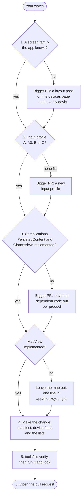

# Adding your own watch

This app supports the watches in [Currently supported](#currently-supported), on
the screens in [section 1](#1-is-it-a-screen-family-the-app-knows). If yours has one of
those screens and one of the three input profiles, adding it is a handful of
list edits and one run of `tools/ciq verify`, and this guide is the whole
procedure.

It is written to be followable if you have never touched this codebase. If a
check fails, skip to [When a check fails](#when-a-check-fails): a failure is
usually a bigger pull request, not a dead end.

**The one thing to take away:** a clean build does not mean a device works.
Section 3 explains why, and it is the reason this guide exists.



Every path ends at the same place. A failed check means a larger change, never
a closed door.

## What you need

The Connect IQ SDK and the device files for the watch you care about, both from
the SDK Manager (a free Garmin account; see
[CONTRIBUTING.md](../CONTRIBUTING.md#setting-up)). Everything below reads files
the SDK Manager has already put on your machine:

```
~/.Garmin/ConnectIQ/Devices/<device-id>/
├── compiler.json                 # family, memory budgets, Connect IQ version
├── simulator.json                # buttons, touch, the action menu indicator
└── <device-id>.api.debug.xml     # which APIs are actually implemented
```

The `<device-id>` is the directory name: `fenix7pro`, `fr955`, `venu3`. It is
not the retail name and you often cannot guess it, so look at the directory
listing.

You do not have to read these files by hand in the end:
`tools/ui/devices/devdata.py` reads all three for every product and writes the
results into the repository (section 4). The commands in sections 1 to 3 are
for deciding before you edit anything.

---

## 1. Is it a screen family the app knows?

```bash
ID=fenix7xpro   # yours

python3 -c "
import json,os
c=json.load(open(os.path.expanduser(f'~/.Garmin/ConnectIQ/Devices/$ID/compiler.json')))
print('family :', c['deviceFamily'])
print('name   :', c['displayName'])
print('memory :', [(t['type'], t.get('memoryLimit')) for t in c['appTypes']])
print('ciq    :', sorted({p['connectIQVersion'] for p in c['partNumbers']}))"
```

The layouts have been through these families:

<!-- devicelists families begin -->
| `deviceFamily` | Screen | Watches today |
|---|---|---|
| `round-218x218` | 218 round, MIP | Forerunner 255S, Forerunner 255S Music |
| `round-240x240` | 240 round, MIP | fēnix 7S, fēnix 7S Pro |
| `round-260x260` | 260 round, MIP | fēnix 7 Pro, fēnix 7, fēnix 7 Pro Solar Edition (no Wi-Fi), fēnix 8 Solar 47mm, fēnix 9 Pro Solar 47mm, Forerunner 955, Forerunner 255, Forerunner 255 Music |
| `round-280x280` | 280 round, MIP | fēnix 7X, fēnix 7X Pro, fēnix 7X Pro Solar Edition (no Wi-Fi), fēnix 8 Solar 51mm, fēnix 9 Pro Solar 51mm, Enduro 3 |
| `round-390x390` | 390 round, AMOLED | epix Pro (Gen 2) 42mm, MARQ (Gen 2), MARQ (Gen 2) Aviator, Descent Mk3 43mm, Descent G2, Venu 3S, vívoactive 5, vívoactive 6, Venu 4 41mm |
| `round-416x416` | 416 round, AMOLED | epix Pro (Gen 2) 47mm, fēnix 8 43mm, Forerunner 265 |
| `round-454x454` | 454 round, AMOLED | fēnix 8 47mm and 51mm, fēnix 8 Pro 47mm and 51mm, fēnix 9 47mm and 51mm, fēnix 9 Pro 47mm, Forerunner 965, Forerunner 970, D2 Mach 2, D2 Mach 2 Pro, epix Pro (Gen 2) 51mm, Descent Mk3i 51mm, Venu 3, Venu 4 45mm |
| `rectangle-448x486` | 448×486 rounded rectangle, AMOLED | Venu X1 |
<!-- devicelists families end -->

And the budget:

| | |
|---|---|
| `deviceFamily` | one of the six above |
| `watchApp` memory | at least 524,288 (512 KB): the Forerunner 255 has exactly that, and the app fits |
| `glance` memory | 65,536 |
| Connect IQ | 5.1.0 or higher, matching `minApiLevel` in `app/manifest.xml` |

`tools/checks.py` holds every product to these numbers ("Every product meets
the minimum"), so a watch below them cannot slip in by accident.

A different family is not a no. The layout already follows the screen: it is
drawn in a logical frame 260 wide, scaled by s = width / 260, and every line is
stacked from the font heights the watch reports and fitted to the outline at
its own y (`ui/Geometry.mc`; [decisions.md](decisions.md#layouts-follow-the-screen-measured-from-the-dc)
has the reasoning). What a new family needs is someone to look at it: a
column on the devices design page drawn as that watch, `node
tools/ui/fitcheck.mjs --devices` clean on it, the family added to
`KNOWN_FAMILIES` in `tools/checks.py`, and a device of that family in
`VERIFY_DEVICES` in `tools/ciq`, so the unit tests run on it. See
[When a check fails](#when-a-check-fails).

---

## 2. Which input profile is it?

The app knows three input profiles, plus a variant of the first, and every
action is reachable in each of them:

| Profile | Buttons | Menu route | Watches today |
|---|---|---|---|
| A | Five buttons and touch | Hold UP (MENU) | fēnix, epix, MARQ, Descent Mk3, Enduro 3, D2 Mach 2, Forerunner 955, 965, 970 |
| A0 | Five buttons, no touch | Hold UP (MENU) | Forerunner 255, 255 Music, or a fēnix with touch switched off |
| B | START, BACK and touch | Hold BACK | Venu 3, Venu 3S |
| C | START, BACK and touch, no MENU | A swipe left, or a tap on Garmin's action menu indicator (`onActionMenu`) | vívoactive 6, Venu 4, Venu X1 |

The full map of which button does what on each screen is in the style guide,
[section 7](design/style-guide.md#three-input-profiles), and the reasoning in
[decisions.md](decisions.md#three-input-profiles-and-every-action-reachable-in-each).

To see which profile your watch is, read its buttons and touch from
`simulator.json`:

```bash
python3 -c "
import json,os
s=json.load(open(os.path.expanduser(f'~/.Garmin/ConnectIQ/Devices/$ID/simulator.json')))
print('touch :', bool(s['display'].get('isTouch')))
print('keys  :', [k['id'] + ('/hold' if k.get('isHold') else '') + ' ' + k['behavior'] for k in s['keys']])
print('hint  :', 'actionMenuHint' in json.dumps(s['layouts']))
print('menu  :', s['layouts'][0]['menu2']['mode'])"
```

Then read the rules top to bottom; the first that matches is the profile:

| You see | Profile |
|---|---|
| `touch : False` | A0 |
| `up` and `down` among the keys | A |
| a key `menu/hold onMenu`, and no `up` or `down` | B |
| none of the above: only `enter` and `esc`, and `hint : True` | C |

The order matters. A five-button watch also has a `menu/hold onMenu` key
(holding UP is MENU there), which is why UP and DOWN are checked first. This is
exactly what `devdata.py` does (`profile()`), and the result lands as `profile`
in `tools/ui/devices/11-devdata.js`.

Then check `menu`: on every supported watch it is `touchButton` for profiles A
and A0 and `scroll` for B and C. The app relies on that pairing: on a
`touchButton` watch Garmin centres the focused row and the lists cover the edge
beyond the three middle rows, on a `scroll` watch they cover nothing
(`NightMenuLayout.masks()`). A watch that breaks the pairing needs that
function changed for it.

A watch that fits none of these, for example one with fewer than five buttons
and no touch, or touch without a START button, needs a new profile. That is a
larger change; see [When a check fails](#when-a-check-fails).

---

## 3. Are the APIs actually implemented?

**This is the step that matters, and the one that looks skippable.**

```bash
f=~/.Garmin/ConnectIQ/Devices/$ID/$ID.api.debug.xml
for sym in Toybox_WatchUi_MapView Toybox_Complications \
           Toybox_PersistedContent Toybox_WatchUi_GlanceView; do
  echo "$sym: $(grep -c $sym $f)"
done
```

Expect roughly `9 / 23 / 15+ / 9` where everything is implemented (the
`PersistedContent` count varies: 15 on the Venu 3S, 27 on the fēnix 7 Pro).

- **`Complications`, `PersistedContent` and `GlanceView` are required.** A zero
  on any of them disqualifies the device as things stand.
- **`MapView` is optional.** A zero means the watch has no onboard maps. The app
  is then built without the map preview: section 4 has the one line that
  does it, and Find my car shows address, distance and bearing, with START
  opening the Find my car list instead of the map.

### Why this is not paranoia

The Forerunner 255 is the same device family as the fēnix 7, the same Connect
IQ version, has enough memory, and **builds perfectly** at the project's
strictest settings. This is what 1.2 printed for it:

```
$ tools/ciq build --all
BUILD SUCCESSFUL
Built app/bin/vozidlo-fr255.prg for fr255: 251436 bytes (31% of budget)
```

No errors. No warnings. And:

```
$ grep -c Toybox_WatchUi_MapView ~/.Garmin/ConnectIQ/Devices/fr255/fr255.api.debug.xml
0
$ grep -c Toybox_WatchUi_MapView ~/.Garmin/ConnectIQ/Devices/fenix7pro/fenix7pro.api.debug.xml
9
```

The Forerunner 255 has no onboard maps. `WatchUi.MapView` type-checks against
it, so the compiler is satisfied, but there is no implementation behind the
type. `ui/MapPreviewView.mc` extends `WatchUi.MapView` at class level, so the
class cannot resolve on that watch.

A green build tells you the compiler was satisfied. It tells you nothing about
whether the app loads. This project has shipped two bugs of exactly that shape:
a glance that crashed on every launch, and text drawn off both edges of the
screen, and both compiled cleanly and passed the entire test suite.
[decisions.md](decisions.md) has both post-mortems.

So up to 1.2 the Forerunner 255 was left out. Since 1.3.0 it ships, with the
map left out of its build: `ui/MapPreviewView.mc` and its delegates carry
`(:map)`, and `app/monkey.jungle` excludes that annotation for the
Forerunner 255. It was added because the device file showed what was missing
and the code was changed to match, not because the build was clean. That is
the lesson, and it is why `tools/checks.py` now fails when a watch without
`MapView` is listed and the map is still linked in.

---

## 4. Make the change

The manifest is the one list you edit. Everything else that names the
supported watches is generated from it and the device facts, by two scripts:

1. **`app/manifest.xml`**: add the product to the product list:

   ```xml
   <iq:product id="fenix7pro"/>
   <iq:product id="your-device-id"/>
   ```

   The first product in the manifest is the primary: the one `tools/ciq
   build`, `run` and `test` use by default. Leave `fenix7pro` there. If the
   device files miss something worth knowing about your watch, add a line
   under "Notes the device files do not give" in the comment above it.

2. **The device facts**: regenerate them from the SDK's files, with your watch
   now in the manifest:

   ```bash
   python3 tools/ui/devices/devdata.py
   ```

   This rewrites `tools/ui/devices/11-devdata.js` (screen, keys, input profile,
   touch, API counts, budgets, glance area, font metrics) and the devices
   page's columns: your watch joins the column with the same screen family,
   input profile, map and font technology, or gets one of its own. Commit it:
   CI has no device files, so this file is what its checks hold everything
   to. Check that the `profile` and `mapView` it wrote for your watch match
   what you found in sections 2 and 3.

3. **The lists**: regenerate them from the manifest and the device facts:

   ```bash
   python3 tools/devicelists.py
   ```

   This rewrites the table in [Currently supported](#currently-supported)
   below, the README's "Supported watches", the store listing's
   "Requirements", the product block of the manifest comment, and the
   per-product lines of `app/monkey.jungle`: the map left out where `MapView`
   is missing (section 3), and the launcher icon folder where the icon is not
   40 px. A watch whose name reads badly from its device file gets an entry
   in `NAMES` at the top of the script.

4. **`app/resources-launcher-<size>/`**, only if `devicelists.py` says the
   folder for your watch's icon size is missing: copy another
   `resources-launcher-*` folder and set the size in both files (54, 60, 65
   and 70 exist).

5. **`tools/ciq`**, only if your watch brings a family, a combination of input
   profile and map, or a Connect IQ version below every device in
   `VERIFY_DEVICES`: add it there, so `tools/ciq verify` runs the unit tests
   on it.

6. **The devices page**: rebuild it with `tools/ui/build-devices.sh`, run
   `node tools/ui/fitcheck.mjs --devices your-device-id`, and look at your
   watch's column in `docs/design/vozidlo-devices.html`.

Then:

```bash
python3 tools/checks.py
```

It tells you what is still missing, by file, including a list that is out of
date with the manifest.

---

## 5. Verify

```bash
tools/ciq verify                # the gate: checks, design pages, every build, the unit tests
CIQ_DEVICE=$ID tools/ciq test   # the unit suite on your watch, if it is not a verify device
CIQ_DEVICE=$ID tools/ciq run    # actually look at it
```

`tools/ciq verify` builds every product with warnings as errors, checks each
build against that watch's memory budget, and runs the unit tests on one watch
per screen family and input profile. It ends with a short block headed "For
the pull request": paste that into the PR. It exits 0 when everything passed,
1 when something failed, and 2 when it could not run at all (a missing device
file, no display for the simulator); 2 is not a pass.

**Run it, do not only build it.** Press through the screens. Open the glance:
a fresh simulator renders the glance before the app, which is the cheapest
guard this project has against the scope bug described in `decisions.md`.

On a five-button watch with touch, go through the screens a second time with
touch switched off in the simulator (profile A0): every action has to be
reachable by the buttons alone.

Then look at the devices page, which draws every screen on every supported
watch with that watch's own fonts:

```bash
tools/ui/build-devices.sh             # docs/design/vozidlo-devices.html
node tools/ui/fitcheck.mjs --devices  # every screen against its own outline
```

`tools/ciq verify` runs both, but open the page and look at your watch's
column: the checks find text that does not fit, not text that looks wrong.

If you own the watch, install it and use it for a day. See
[INSTALL.md](../INSTALL.md).

---

## 6. Open the pull request

The template asks for the summary `tools/ciq verify` printed and the output of
the commands in sections 1 to 3. Paste them rather than ticking boxes from
memory: they are the evidence the device decision rests on, and they take a
reviewer ten seconds to confirm. CI checks that the lists agree; it cannot
build the app, so your verify run is the only build anyone sees before the
maintainer runs it again.

Say plainly whether you own the watch. **"I own this and used it for a week" is
worth more than everything else in the PR.** If you do not own it, say that
too: the change will still be considered, it will just be described honestly in
the store listing, which promises nothing untested.

---

## When a check fails

None of these is a refusal. They are all larger pull requests, and all of them
are welcome: just say in the PR which one you are doing, so it gets reviewed
as the change it is.

**A new screen family.** The layout scales, but nobody has looked at it on
that screen yet. Regenerate the device facts (the watch gets a column of its
own), rebuild the devices page, and fix what
`node tools/ui/fitcheck.mjs --devices` and your own eyes find, in the design
first and then in `ui/Geometry.mc` and the views. Measure the font heights
the simulator reports and add them to `LIVE_HEIGHTS` in `devdata.py`. A
profile C watch needs the position of Garmin's action menu indicator
(`actionMenuHint` in `11-devdata.js`) in `Geo.hintFor`; a rectangle needs its
corner radius in `Geo.cornerFor`. Then add the family to `KNOWN_FAMILIES` in
`tools/checks.py` and a device of it to `VERIFY_DEVICES` in `tools/ciq`.

**A missing required API.** Move the dependent code behind an annotation and
exclude it per product in `app/monkey.jungle`, the way the map is handled:
`(:map)` on the classes that need `MapView`, a `(:map)`/`(:nomap)` pair where
`ui/LocationView.mc` opens the map, and a runtime `has` check as a second
guard. Complications, waypoints and the glance are each smaller than the map
was, but each needs a fallback someone has thought through.

**A new input.** If the watch fits none of the profiles in section 2, it needs
a new one: a way for every action to be reached with what the watch has. Start
from the route table in the style guide's
[section 7](design/style-guide.md#three-input-profiles), add the profile to
`INPUT` in `tools/ui/devices/10-profiles.js` with its button map, then extend `Geo.inputFrom()` and
`ui/InputProfile.mc`. This is the largest change on the list, and the one to
discuss in an issue first.

**Not enough memory.** Probably genuinely out of reach. The app needs a
watch-app budget of at least 512 KB, and the glance arena is a hard 65,536
bytes.

---

## Currently supported

<!-- devicelists begin -->
| Device id | Watch | Screen | Input | Map |
|---|---|---|---|---|
| `fr255s` | Forerunner 255S (watch-app budget 524,288 B) | 218 round, MIP | A0 | no |
| `fr255sm` | Forerunner 255S Music | 218 round, MIP | A0 | no |
| `fenix7s` | fēnix 7S | 240 round, MIP | A | yes |
| `fenix7spro` | fēnix 7S Pro | 240 round, MIP | A | yes |
| `fenix7pro` | fēnix 7 Pro, Solar, Sapphire Solar, Sapphire Dual Power | 260 round, MIP | A | yes |
| `fenix7` | fēnix 7, quatix 7, Sapphire Dual Power | 260 round, MIP | A | yes |
| `fenix7pronowifi` | fēnix 7 Pro Solar Edition (no Wi-Fi) | 260 round, MIP | A | yes |
| `fenix8solar47mm` | fēnix 8 Solar 47mm | 260 round, MIP | A | yes |
| `fenix9prosolar47mm` | fēnix 9 Pro Solar 47mm | 260 round, MIP | A | yes |
| `fr955` | Forerunner 955, 955 Solar | 260 round, MIP | A | yes |
| `fr255` | Forerunner 255 (watch-app budget 524,288 B) | 260 round, MIP | A0 | no |
| `fr255m` | Forerunner 255 Music | 260 round, MIP | A0 | no |
| `fenix7x` | fēnix 7X, tactix 7, quatix 7X Solar, Enduro 2 | 280 round, MIP | A | yes |
| `fenix7xpro` | fēnix 7X Pro | 280 round, MIP | A | yes |
| `fenix7xpronowifi` | fēnix 7X Pro Solar Edition (no Wi-Fi) | 280 round, MIP | A | yes |
| `fenix8solar51mm` | fēnix 8 Solar 51mm, tactix 8 Solar 51mm | 280 round, MIP | A | yes |
| `fenix9prosolar51mm` | fēnix 9 Pro Solar 51mm | 280 round, MIP | A | yes |
| `enduro3` | Enduro 3 | 280 round, MIP | A | yes |
| `epix2pro42mm` | epix Pro (Gen 2) 42mm | 390 round, AMOLED | A | yes |
| `marq2` | MARQ (Gen 2), Athlete, Adventurer, Captain, Golfer, Carbon Edition, Commander Carbon Edition | 390 round, AMOLED | A | yes |
| `marq2aviator` | MARQ (Gen 2) Aviator | 390 round, AMOLED | A | yes |
| `descentmk343mm` | Descent Mk3 43mm, Mk3i 43mm (Connect IQ 5.1.0) | 390 round, AMOLED | A | yes |
| `descentg2` | Descent G2 (Connect IQ 5.1.0) | 390 round, AMOLED | A | no |
| `venu3s` | Venu 3S | 390 round, AMOLED | B | no |
| `vivoactive5` | vívoactive 5 | 390 round, AMOLED | B | no |
| `vivoactive6` | vívoactive 6 | 390 round, AMOLED | C | no |
| `venu441mm` | Venu 4 41mm | 390 round, AMOLED | C | no |
| `epix2pro47mm` | epix Pro (Gen 2) 47mm, quatix 7 Pro | 416 round, AMOLED | A | yes |
| `fenix843mm` | fēnix 8 43mm | 416 round, AMOLED | A | yes |
| `fr265` | Forerunner 265 | 416 round, AMOLED | A | no |
| `fenix847mm` | fēnix 8 47mm and 51mm, tactix 8, quatix 8 | 454 round, AMOLED | A | yes |
| `fenix8pro47mm` | fēnix 8 Pro 47mm and 51mm, MicroLED, quatix 8 Pro | 454 round, AMOLED | A | yes |
| `fenix947mm` | fēnix 9 47mm and 51mm | 454 round, AMOLED | A | yes |
| `fenix9pro47mm` | fēnix 9 Pro 47mm | 454 round, AMOLED | A | yes |
| `fr965` | Forerunner 965 | 454 round, AMOLED | A | yes |
| `fr970` | Forerunner 970 | 454 round, AMOLED | A | yes |
| `d2mach2` | D2 Mach 2 | 454 round, AMOLED | A | yes |
| `d2mach2pro` | D2 Mach 2 Pro | 454 round, AMOLED | A | yes |
| `epix2pro51mm` | epix Pro (Gen 2) 51mm, D2 Mach 1 Pro, tactix 7 AMOLED Edition | 454 round, AMOLED | A | yes |
| `descentmk351mm` | Descent Mk3i 51mm (Connect IQ 5.1.0) | 454 round, AMOLED | A | yes |
| `venu3` | Venu 3 | 454 round, AMOLED | B | no |
| `venu445mm` | Venu 4 45mm, D2 Air X15 | 454 round, AMOLED | C | no |
| `venux1` | Venu X1 | 448×486 rectangle, AMOLED | C | yes |
<!-- devicelists end -->

Deliberately excluded, with the reasoning in `app/manifest.xml`:

| Device | Why |
|---|---|
| `fenix6` | Connect IQ 3.x, below `minApiLevel`; also half the memory needed and no glance support |
| `fenix6pro` | Connect IQ 3.x, below `minApiLevel` |
| `vivoactive4` | Connect IQ 3.x, below `minApiLevel` |
| `approachs62` | Connect IQ 3.x, below `minApiLevel` |
| `venu2` | Connect IQ 5.0, below `minApiLevel` |
| `venu2s` | Connect IQ 5.0, below `minApiLevel` |
| `venu2plus` | Connect IQ 5.0, below `minApiLevel` |
| `fenix943mm` | fēnix 9 43mm: round 416×416, not added yet, no known blocker |
| `fr265s` | Forerunner 265S: round 360×360, a family that needs a layout pass |
